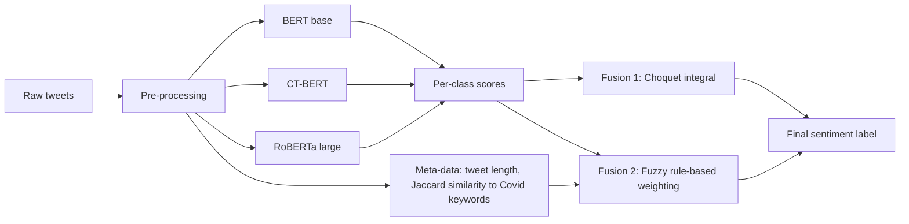

# Fuzzy Fusion of Deep Learning based Text Classification

A hybrid fuzzy deep learning approach for classifying Covid-19 related tweets (positive / negative / neutral).

Three fine-tuned transformer classifiers (BERT, RoBERTa, Covid-Twitter-BERT) are combined by one of two fuzzy fusion methods:

1. **Fuzzy Choquet integral**: a per-class fuzzy-measure aggregation of the three classifiers' scores.
2. **Fuzzy rule-based fusion**: a fuzzy inference system that sets the weight of each classifier per tweet, based on tweet length and Covid-relatedness.

> This repository accompanies the published paper cited below. The paper itself is © Springer Nature and is **not** included here; see [Citation](#citation) and [Copyright and attribution](#copyright-and-attribution).

## Workflow at a glance

A more detailed diagram and a step-by-step explanation are in [docs/how-it-works.md](docs/how-it-works.md).

## What is innovative

- **Fuzzy fusion of pre-trained language models.** User-generated text is inherently uncertain: a tweet can belong *to some degree* to the set of "Covid-related" tweets and *to some degree* to the set of "long" tweets. Fuzzy logic expresses this graded membership instead of picking a single model or using hard votes.
- **Meta-data driven model weighting.** The rule base routes trust between models using two cheap tweet-level signals (length, domain relatedness), e.g. leaning on CT-BERT for highly Covid-related tweets and on RoBERTa for longer ones.
- **Interpretable fusion layer.** The rule base is a small set of human-readable IF-THEN rules, unlike a black-box stacking network.
- **Complementary models.** A general model (BERT), a large robust model (RoBERTa) and a domain-specific model (CT-BERT) cover different kinds of tweets.
- According to the paper, this was the first fuzzy fusion model for health-related social media text.

## Repository layout

| Path | Contents |
|------|----------|
| `src/Final_CHi_Sentiment_V7_3class.ipynb` | Train the 3 classifiers, then Choquet integral fusion (fuzzy measure learned from validation scores) |
| `src/Final_densities_CHi_Sentiment_V7_3class.ipynb` | Same pipeline; Choquet fuzzy measure built from per-model densities (accuracies) |
| `src/Final_rulebase_Sentiment_V7_3class.ipynb` | Train the 3 classifiers, then fuzzy rule-based fusion |
| `docs/how-it-works.md` | Method guide, detailed workflow diagram, rule table |
| `CITATION.cff` | Machine-readable citation |
| `LICENSE` | MIT license for the code and documentation |

The notebooks were written for Google Colab (they mount Google Drive and expect `train.csv`, `valid.csv` and `test.csv` there).

## Quick start

1. Get tweet IDs from the [COVID-19 Tweets dataset](https://github.com/lopezbec/COVID19_Tweets_Dataset) and hydrate them (the paper used TWARC); labels are positive / negative / neutral.
2. Create `train.csv`, `valid.csv`, `test.csv` with columns `full_text` and `Sentiment_Label` in your Drive working directory (default `My Drive/SEN_BERT`).
3. Open a notebook in Colab and run it top to bottom. Each trains BERT, CT-BERT and RoBERTa with 5-fold cross-validation (max length 40, batch size 16, 5 epochs), then runs its fusion step.
4. The rule-based notebook also needs a `fuzzy_system` package and `word_count` / `jacc_sim` columns in its result file. The Choquet notebooks need the `ChI` module and `cvxopt`.

## Results reported in the paper

On test data the individual models reach about 80.3-81.1% accuracy, the Choquet fusions 81.4% and 81.6%, and the fuzzy rule-based fusion 82.0%, the best. See the paper for the full evaluation.

## Citation

If you use this work, please cite:

Ghadiri, Nasser, Ali Ghadiri, and Afrooz Sheikholeslami. "A Fuzzy Deep Learning Approach to Health-Related Text Classification." In *Intelligent and Fuzzy Systems (INFUS 2021)*, Lecture Notes in Networks and Systems 308, pp. 179-186. Springer, Cham, 2022. https://doi.org/10.1007/978-3-030-85577-2_21

[Paper](https://link.springer.com/chapter/10.1007/978-3-030-85577-2_21) |
[Data](https://github.com/lopezbec/COVID19_Tweets_Dataset)

## Copyright and attribution

The source code and documentation in this repository are released under the [MIT License](LICENSE). The published paper's text, figures and tables are © the authors / Springer Nature and are not covered by that license; they are not reproduced in this repository. The descriptions here are brief summaries of the method; refer to the published version for full details. Third-party models (BERT, RoBERTa, CT-BERT) and the dataset keep their original licenses.
