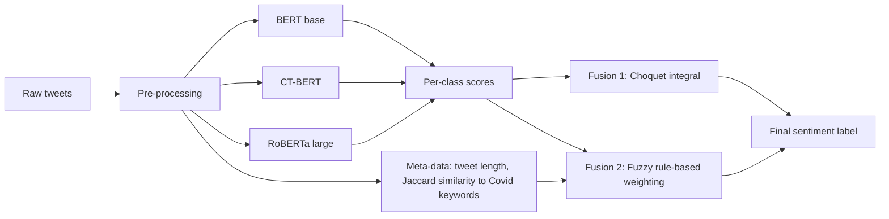

# Fuzzy Fusion of Deep Learning based Text Classification

A hybrid fuzzy deep learning approach for classifying Covid-19 related tweets (positive / negative / neutral).

Three fine-tuned transformer classifiers (BERT, RoBERTa, Covid-Twitter-BERT) are combined by one of two fuzzy fusion methods:

1. **Fuzzy Choquet integral**: a per-class fuzzy-measure aggregation of the three classifiers' scores.
2. **Fuzzy rule-based fusion**: a fuzzy inference system that sets the weight of each classifier per tweet, based on tweet length and Covid-relatedness.

In the paper's evaluation, both fusion methods beat each individual model on test accuracy, with the rule-based fusion best at 82.0% against 80.3-81.1% for the single models.

This repository holds the Colab notebooks that implement the pipeline (`src/`) and a short guide to the method (`docs/`).

> Fuzzy logic background: [Wikipedia](https://en.wikipedia.org/wiki/Fuzzy_logic)

## Why it is different

| Idea | What it buys you |
|---|---|
| **Fuzzy fusion of pre-trained models.** A tweet can belong *to some degree* to the set of "Covid-related" tweets and *to some degree* to the set of "long" tweets. | Graded membership replaces picking a single model or taking hard votes. |
| **Meta-data driven weighting.** Two cheap tweet-level signals (length, Jaccard similarity to Covid keywords) set each model's weight. | Trust shifts toward CT-BERT for highly Covid-related tweets and toward RoBERTa for longer ones. |
| **Interpretable fusion layer.** The rule base is a small set of human-readable IF-THEN rules. | Unlike a black-box stacking network, you can read why a model was trusted. |
| **Complementary models.** A general model (BERT), a large robust model (RoBERTa) and a domain-specific model (CT-BERT). | Different kinds of tweets are covered by different models. |

According to the paper, this was the first fuzzy fusion model for health-related social media text. See [docs/how-it-works.md](docs/how-it-works.md) for the details.

## Workflow



A more detailed diagram and a step-by-step explanation are in [docs/how-it-works.md](docs/how-it-works.md).

## Repository layout

| Path | Contents |
|------|----------|
| `src/Final_CHi_Sentiment_V7_3class.ipynb` | Train the 3 classifiers, then Choquet integral fusion (fuzzy measure learned from validation scores) |
| `src/Final_densities_CHi_Sentiment_V7_3class.ipynb` | Same pipeline; Choquet fuzzy measure built from per-model densities (accuracies) |
| `src/Final_rulebase_Sentiment_V7_3class.ipynb` | Train the 3 classifiers, then fuzzy rule-based fusion |
| `docs/how-it-works.md` | Method guide, detailed workflow diagram, rule table |
| `docs/usage.md` | Data preparation, requirements and how to run the notebooks |
| `CITATION.cff` | Machine-readable citation |
| `LICENSE` | MIT license for the code and documentation |

## Quick start

Data preparation, requirements and the input file formats are in [docs/usage.md](docs/usage.md). In short:

1. Hydrate the tweets from the [COVID-19 Tweets dataset](https://github.com/lopezbec/COVID19_Tweets_Dataset) and put `train.csv`, `valid.csv`, `test.csv` in your Google Drive working directory.
2. Open one of the notebooks in `src/` in Google Colab and run it top to bottom.

## Paper

Ghadiri, N., Ghadiri, A., Sheikholeslami, A.: *A Fuzzy Deep Learning Approach to Health-Related Text Classification.* In: Intelligent and Fuzzy Systems (INFUS 2021), LNNS 308, pp. 179-186. Springer, Cham (2022).
[Publisher page](https://link.springer.com/chapter/10.1007/978-3-030-85577-2_21) | [DOI](https://doi.org/10.1007/978-3-030-85577-2_21) | [Data](https://github.com/lopezbec/COVID19_Tweets_Dataset)

The paper contains the full description, experimental setup, tables and figures. The documents here are an independent, shorter guide to the code, not a reproduction of the paper.

If you use this work, please cite:

```bibtex
@inproceedings{ghadiri2022fuzzy,
  title     = {A Fuzzy Deep Learning Approach to Health-Related Text Classification},
  author    = {Ghadiri, Nasser and Ghadiri, Ali and Sheikholeslami, Afrooz},
  booktitle = {Intelligent and Fuzzy Systems (INFUS 2021)},
  series    = {Lecture Notes in Networks and Systems},
  volume    = {308},
  pages     = {179--186},
  publisher = {Springer, Cham},
  year      = {2022},
  doi       = {10.1007/978-3-030-85577-2_21}
}
```

## License and copyright

- **Code** in this repository is released under the [MIT License](LICENSE).
- **The published paper** remains under the copyright of its publisher (Springer Nature, 2022). It is not included in this repository, and nothing here reproduces its text, figures or tables. Please use the links above to read it.
- **The documentation** in this repository is original explanatory text written for this project.
- **Third-party models and data** (BERT, RoBERTa, CT-BERT and the COVID-19 Tweets dataset) keep their original licenses.
