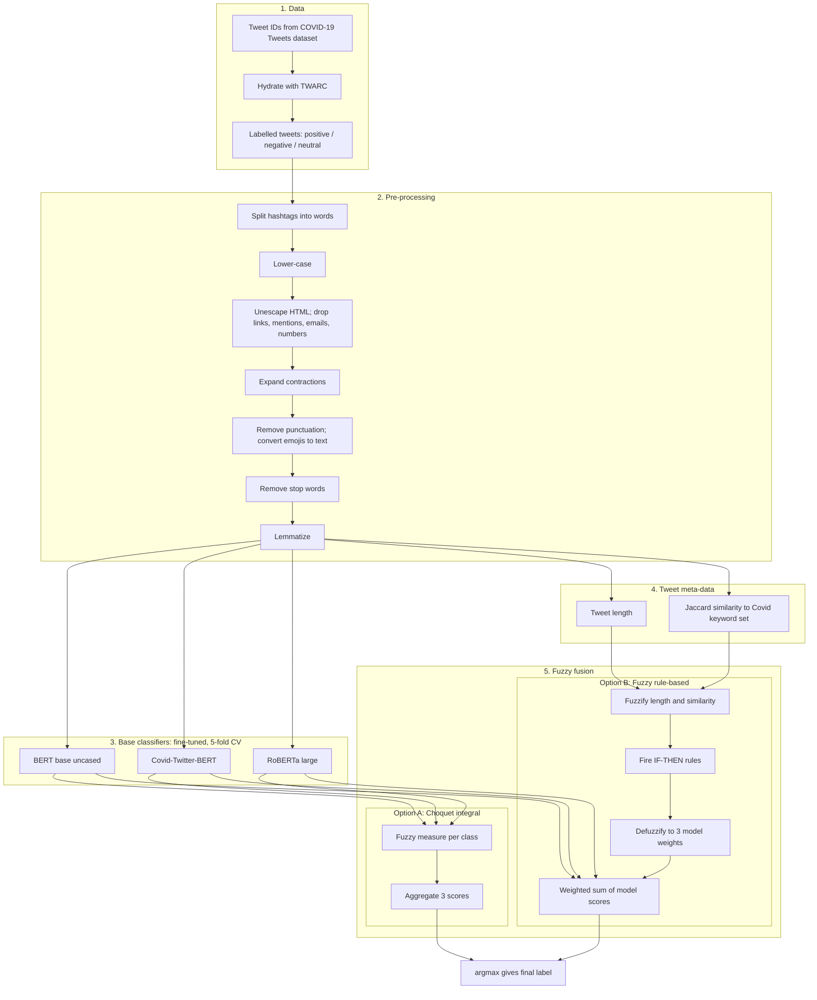

# How it works

This guide summarises the method implemented in the notebooks under `src/`. For the authoritative description and evaluation, see the published paper (DOI 10.1007/978-3-030-85577-2_21).

## End-to-end workflow

## Stages

### 1. Data
English tweets from the public COVID-19 Tweets dataset, restricted to those meeting like / retweet / length criteria, hydrated from IDs and labelled positive, negative or neutral. The data is not redistributed here.

### 2. Pre-processing
Social-media text is noisy, so tweets are normalised first: hashtag segmentation, case folding, removal of URLs/mentions/emails/numbers, contraction expansion, punctuation and emoji handling, stop-word removal and lemmatization.

### 3. Base classifiers
Three pre-trained transformers are fine-tuned independently for 3-class sentiment (max sequence length 40, batch size 16, 5 epochs, 5-fold cross-validation):

| Model | Role |
|-------|------|
| `bert-base-uncased` | general-purpose baseline |
| `roberta-large` | expected to be stronger on longer text |
| `digitalepidemiologylab/covid-twitter-bert` | domain-specific for Covid tweets |

Each outputs a score vector over the three classes for every tweet. No single model wins everywhere, which motivates fusion.

### 4. Fusion option A: Choquet integral
A Choquet integral aggregates the three models' scores for each class. Unlike a weighted average, its **fuzzy measure** assigns a value to every *subset* of models, so it can capture redundancy or synergy between them. Two variants:

- `Final_CHi_...`: the measure is learned from validation scores (quadratic programming via `cvxopt`).
- `Final_densities_CHi_...`: the measure is derived from per-model *densities* (individual validation accuracies) with a Sugeno-style construction.

### 5. Fusion option B: fuzzy rule-based weighting
Two inputs are computed per tweet:

- **word_len**: tweet length, fuzzified into Low / Medium / High.
- **similarity**: Jaccard similarity between the tweet and a fixed set of Covid keywords, fuzzified into Low / Medium / High (a proxy for Covid-relatedness).

Eight IF-THEN rules map these to a weight level (Low / Medium / High) for each of the three models. The fuzzy output is defuzzified into weights in [0, 1], and the final prediction is the argmax of the weighted sum of the three models' scores. If no rule fires, equal weights (1/3 each) are used.

Rule table as implemented in `Final_rulebase_Sentiment_V7_3class.ipynb`:

| word_len | similarity | BERT | CT-BERT | RoBERTa |
|----------|-----------|------|---------|---------|
| L | L | M | M | H |
| M | L | L | L | H |
| H | L | L | M | H |
| L | M | M | M | M |
| M | M | L | M | H |
| H | M | L | L | H |
| M | H | L | H | M |
| H | H | L | H | M |

Reading the table: highly Covid-related tweets shift trust toward CT-BERT, while longer or less related tweets shift it toward RoBERTa. The notebook defines no rule for the (L, H) combination (short, highly related); the fallback for inputs where no rule fires is equal weights.

## Why fuzzy logic here?
Tweet properties such as "long" or "Covid-related" are matters of degree. Fuzzy sets let several rules fire partially at once, giving smooth transitions between models rather than hard switching, and the resulting weights remain human-readable.

## Reproducibility notes
- Seeds are fixed (`SEED = 42`).
- The notebooks are Colab-oriented (Google Drive paths) and depend on helper modules (`ChI`, `fuzzy_system`) that are not in this repo.
